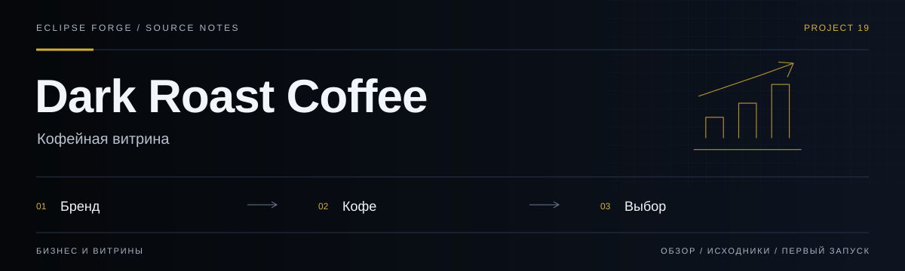
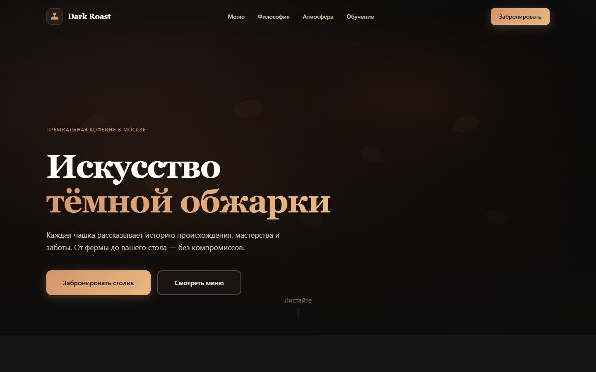
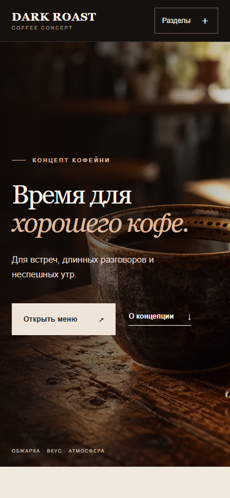

# Dark Roast Coffee

<!-- project-links:start -->
[Открыть веб-версию](https://pavelhopson.github.io/dark_roast_coffee/) · [Документация](docs/repository-guide.md) · [Код](https://github.com/PavelHopson/dark_roast_coffee/tree/main) · [История изменений](https://github.com/PavelHopson/dark_roast_coffee/commits/main/)
<!-- project-links:end -->



**Кофейная витрина.** Визуальный сайт кофейного бренда: продукт, атмосфера и контент в статическом веб-формате.

<!-- eclipse-forge-projects:start -->
## Проекты Eclipse Forge

[Главная Eclipse Forge](https://eclipse-forge.ru/) · [Eclipse Library](https://library.eclipse-forge.ru/) · [Eclipse DnD Forge](https://dnd.eclipse-forge.ru/)

Исходный код: [Eclipse Forge Landing](https://github.com/PavelHopson/Eclipse-forge-website) · [Eclipse Chat](https://github.com/PavelHopson/eclipse-chat) · [Eclipse Library](https://github.com/PavelHopson/eclipse-library) · [Eclipse AI Hub](https://github.com/PavelHopson/eclipse-ai-hub) · [Eclipse Sentinel](https://github.com/PavelHopson/eclipse-hopson-sentinel) · [Eclipse Webclaw](https://github.com/PavelHopson/Eclipse-webclaw) · [Eclipse DnD Forge](https://github.com/PavelHopson/eclipse-dnd-forge) · [Finflow](https://github.com/PavelHopson/finflow) · [Eclipse Media](https://github.com/PavelHopson/eclipse-media) · [Shotforge](https://github.com/PavelHopson/shotforge) · [Text2Image](https://github.com/PavelHopson/Text2Image) · [Educator AI](https://github.com/PavelHopson/Educator-AI) · [@pavelhopson/retry-http](https://github.com/PavelHopson/retry-http)
<!-- eclipse-forge-projects:end -->

<!-- repository-guide:start -->
[Интерфейс](#readme-interface) · [Первый запуск](#readme-start) · [Что внутри](#readme-map) · [Путеводитель](docs/repository-guide.md#start) · [Карта кода](docs/repository-guide.md#map) · [Проверки](docs/repository-guide.md#checks) · [Границы и права](docs/repository-guide.md#boundaries)

<a id="readme-interface"></a>

## Интерфейс



**Главная Dark Roast: концепция, меню и атмосфера.** Изображение первого экрана создано ИИ.

Локальный снимок от 1 ноября 2026: отдельный профиль браузера, без внешних API и пользовательских секретов. Это вид интерфейса, не подтверждение production-функций.

<details>
<summary><strong>Мобильный экран · 390 px</strong></summary>



</details>

[Открыть в полном размере](docs/assets/ui/overview.png) · [Данные снимка](docs/assets/ui/capture.json)

<a id="readme-map"></a>

## Проект за минуту

- **[Главная](<pages/homepage.html>)** — Брендовая история и вход в кофейную витрину.
- **[Меню](<pages/menu_experience.html>)** — Страница выбора кофе и вариантов приготовления.
- **[Интерактивность](<js/pages.js>)** — фильтры, демонстрационная корзина и квиз.

<a id="readme-start"></a>

## Начать локально

**Среда:** Браузер; Python 3 для HTTP-просмотра. **Источник:** [pages/homepage.html](<pages/homepage.html>).

Из корня клонированного репозитория:

```bash
python -m http.server 8000 --bind 127.0.0.1
```

Откройте http://127.0.0.1:8000/pages/homepage.html. `npm run dev` здесь следит за CSS, а не поднимает сайт. Build-скрипты содержат npx-вызовы; зависимости нужно отдельно проверить.

<details>
<summary><strong>Перед первым запуском и изменением кода</strong></summary>

- Команды сверены с исходниками 8 сентября 2026. Это инструкция, а не отметка об успешном запуске или текущем production.
- Установка зависимостей может обращаться в registry и выполнять lifecycle scripts. Используйте отдельную рабочую среду и демонстрационные данные.
- Контент и изображения проверяются на права; коммерческие обещания должны соответствовать реальному предложению.


</details>
<!-- repository-guide:end -->

## О проекте

**Dark Roast Coffee** — многостраничный концепт кофейни с тёплой палитрой и адаптивной вёрсткой. Контент, цены и форма бронирования демонстрационные.

**[→ Открыть демо](https://pavelhopson.github.io/dark_roast_coffee/pages/homepage.html)**

---

## Страницы

| Страница | Описание |
|----------|----------|
| [Homepage](https://pavelhopson.github.io/dark_roast_coffee/pages/homepage.html) | Главная концепта: кофе, меню и атмосфера |
| [Menu](https://pavelhopson.github.io/dark_roast_coffee/pages/menu_experience.html) | Фильтр по обжарке и демонстрационная корзина в браузере; оформление заказа не подключено |
| [Philosophy](https://pavelhopson.github.io/dark_roast_coffee/pages/our_philosophy.html) | Концепция и принципы приготовления кофе |
| [Atmosphere](https://pavelhopson.github.io/dark_roast_coffee/pages/atmosphere_gallery.html) | Галерея с фильтром; иллюстрации концепта созданы ИИ |
| [Reservation](https://pavelhopson.github.io/dark_roast_coffee/pages/reservation_system.html) | Демонстрационная форма: заявка не отправляется и бронирование не создаётся |
| [Education](https://pavelhopson.github.io/dark_roast_coffee/pages/coffee_education_center.html) | Способы заваривания и квиз из трёх вопросов |

---

## Реализация

Статические HTML-страницы, локальные CSS и JavaScript; серверная часть не требуется. Основные стили находятся в `css/home-editorial.css` и `css/inner-editorial.css`, интерактивность — в `js/home.js` и `js/pages.js`.

- Корзина сохраняется в localStorage текущего браузера и не отправляет заказы.
- Форма бронирования демонстрационная: данные не отправляются и столик не бронируется.
- В галерее использованы иллюстрации, созданные ИИ.
- Без JavaScript форма бронирования недоступна, а содержимое страниц остаётся читаемым.

Для просмотра достаточно локального HTTP-сервера, как указано выше. Установка зависимостей не нужна.

---

## Лицензия

[MIT](LICENSE)

---

<div align="center">
<sub>Сделано с ☕ в Eclipse Forge</sub>
</div>
